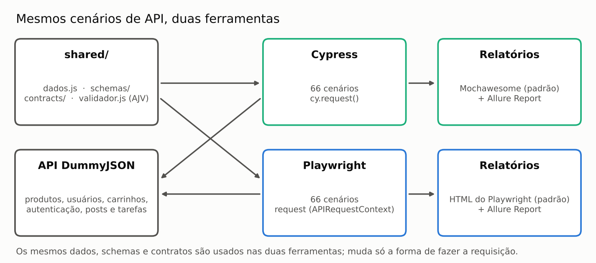
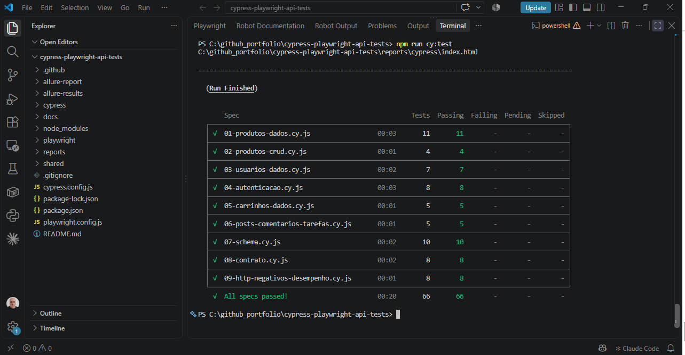
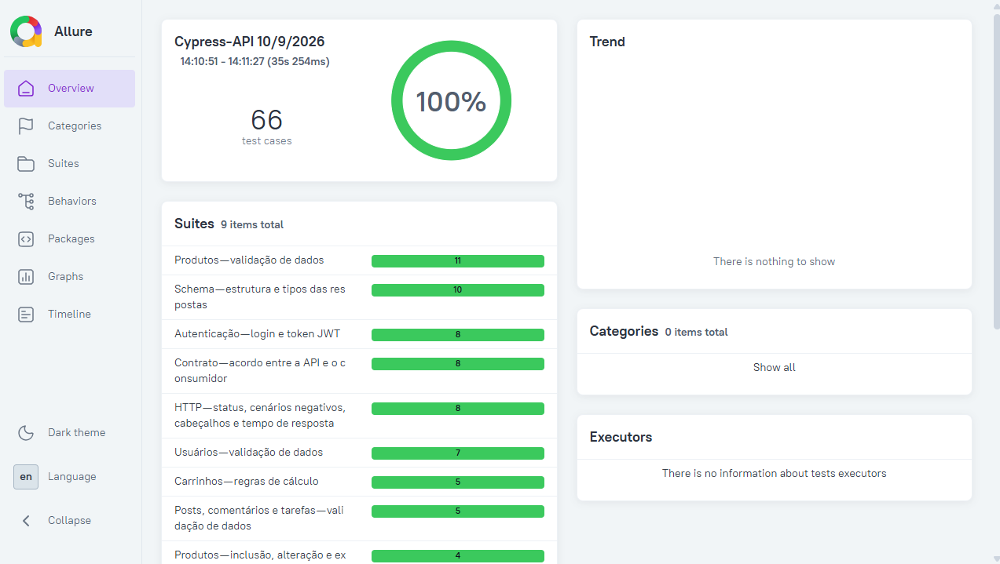
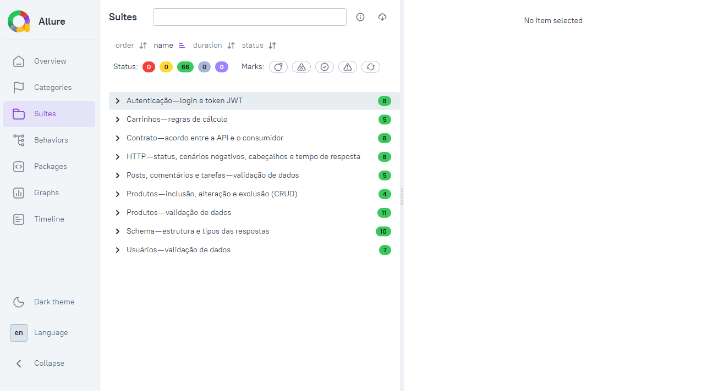
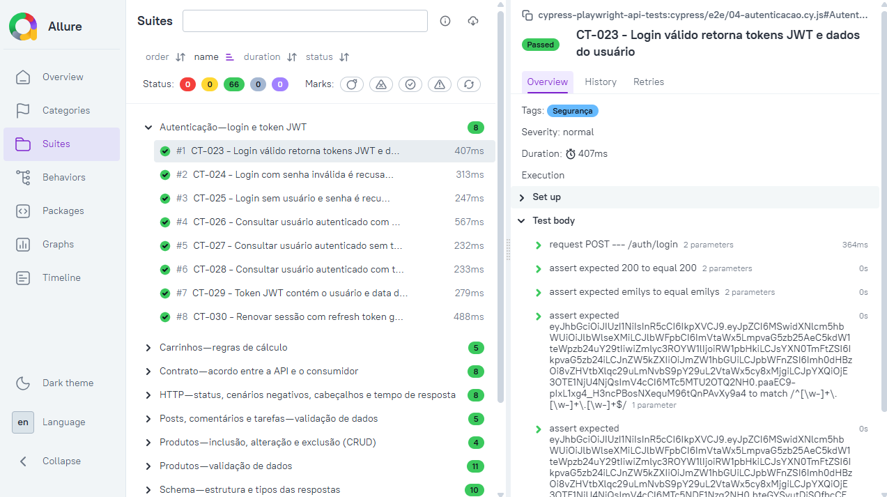

# Cypress Playwright API Tests

Testes automatizados de **API REST** com **Cypress** e **Playwright**, em JavaScript (Node.js): **66 cenários** cobrindo validação de dados, JSON Schema, testes de contrato, autenticação JWT, CRUD, cenários negativos, cabeçalhos e tempo de resposta. Relatórios em **Allure Report** e no relatório padrão de cada ferramenta.




## Sumário

1. [API testada](#-api-testada)
2. [Tipos de teste](#-tipos-de-teste)
3. [Evidências de execução](#-evidências-de-execução)
4. [Catálogo de cenários](#-catálogo-de-cenários)
5. [Como começar](#-como-começar)
6. [Como executar](#-como-executar)
7. [Relatórios](#-relatórios)
8. [Estrutura do projeto](#-estrutura-do-projeto)
9. [Decisões técnicas](#-decisões-técnicas)
10. [CI](#-ci)
11. [Perguntas frequentes em entrevista técnica](#-perguntas-frequentes-em-entrevista-técnica)

---

## 🎯 API testada

[DummyJSON](https://dummyjson.com): API REST pública para testes, sem chave de acesso, com produtos, usuários, carrinhos, autenticação JWT, posts, comentários e tarefas.

Inclusões, alterações e exclusões (POST, PUT, PATCH e DELETE) são **simuladas** pela DummyJSON: a API responde como se tivesse gravado, mas não altera os dados no servidor. Por isso os testes podem ser executados quantas vezes forem necessárias, sem efeito colateral.

---

## 🧪 Tipos de teste

| Tipo | O que valida | Cenários |
|---|---|---|
| **Dados** | Valores e regras de negócio: ids, faixas de preço e avaliação, paginação, ordenação, filtros, busca, cálculos do carrinho | 28 |
| **CRUD** | Inclusão, alteração (PUT e PATCH) e exclusão | 4 |
| **Segurança (autenticação)** | Login, token JWT, acesso com e sem token, renovação de sessão | 8 |
| **Schema** | Estrutura e tipos de cada resposta, com JSON Schema (AJV) | 10 |
| **Contrato** | Acordo rígido entre API e consumidor: campos exatos, valores permitidos (enum) e nenhum campo extra | 8 |
| **HTTP, negativos e desempenho** | Status 404 e 500, rota inexistente, cabeçalho `Content-Type` e tempo de resposta | 8 |
| **Total** | | **66** |

Os **mesmos 66 cenários** estão implementados no Cypress e no Playwright, com os mesmos dados, schemas e contratos (pasta `shared/`).

### Schema x contrato

| | Teste de schema | Teste de contrato |
|---|---|---|
| Pergunta | "A resposta tem a estrutura e os tipos certos?" | "A API continua cumprindo exatamente o que foi acordado com quem a consome?" |
| Campos extras | Aceitos | **Reprovam** o teste (`additionalProperties: false`) |
| Valores | Tipos e faixas (ex.: `rating` entre 0 e 5) | Valores permitidos (enum), ex.: `availabilityStatus` |
| Detecta | Campo com tipo errado ou ausente | Campo removido, renomeado ou adicionado sem aviso (quebra de contrato) |
| Arquivos | `shared/schemas/` | `shared/contracts/` |

---

## 📸 Evidências de execução

Execução real no Cypress, contra a API DummyJSON: **66 cenários executados, 66 aprovados (100%).**

**Terminal — resumo da execução dos 9 arquivos de teste:**



**Allure Report — visão geral (100% aprovado):**



**Allure Report — cenários agrupados por suíte:**



**Allure Report — detalhe de um cenário (CT-023, login com token JWT):** requisição, status e cada verificação registrados passo a passo.



---

## 📋 Catálogo de cenários

<details>
<summary><b>Produtos — Dados (CT-001 a CT-011)</b></summary>

| ID | Cenário |
|---|---|
| CT-001 | Consultar produto por id retorna o produto correto |
| CT-002 | Produto possui preço, desconto, avaliação e estoque em faixas válidas |
| CT-003 | Listagem padrão retorna 30 produtos a partir do início |
| CT-004 | Paginação com limit e skip retorna a página correta |
| CT-005 | Parâmetro select retorna somente os campos solicitados |
| CT-006 | Ordenação por preço crescente |
| CT-007 | Ordenação por preço decrescente |
| CT-008 | Busca por termo retorna resultados coerentes com o total |
| CT-009 | Produtos por categoria pertencem somente à categoria pesquisada |
| CT-010 | Lista de categorias contém categorias conhecidas |
| CT-011 | URL de cada categoria aponta para o próprio slug |

</details>

<details>
<summary><b>Produtos — CRUD (CT-012 a CT-015)</b></summary>

| ID | Cenário |
|---|---|
| CT-012 | Incluir produto retorna o produto criado com novo id |
| CT-013 | Alterar produto com PUT atualiza o título |
| CT-014 | Alterar produto com PATCH atualiza somente o preço |
| CT-015 | Excluir produto retorna isDeleted e data de exclusão |

</details>

<details>
<summary><b>Usuários — Dados (CT-016 a CT-022)</b></summary>

| ID | Cenário |
|---|---|
| CT-016 | Consultar usuário por id retorna o usuário correto |
| CT-017 | E-mails dos usuários têm formato válido |
| CT-018 | Filtro por cor de cabelo retorna somente usuários com a cor filtrada |
| CT-019 | Busca por nome encontra o usuário pesquisado |
| CT-020 | Carrinhos do usuário pertencem ao próprio usuário |
| CT-021 | Posts do usuário pertencem ao próprio usuário |
| CT-022 | Tarefas do usuário pertencem ao próprio usuário |

</details>

<details>
<summary><b>Autenticação — Segurança (CT-023 a CT-030)</b></summary>

| ID | Cenário |
|---|---|
| CT-023 | Login válido retorna tokens JWT e dados do usuário |
| CT-024 | Login com senha inválida é recusado |
| CT-025 | Login sem usuário e senha é recusado |
| CT-026 | Consultar usuário autenticado com token válido |
| CT-027 | Consultar usuário autenticado sem token é recusado |
| CT-028 | Consultar usuário autenticado com token inválido é recusado |
| CT-029 | Token JWT contém o usuário e data de expiração posterior à emissão |
| CT-030 | Renovar sessão com refresh token gera novo access token |

</details>

<details>
<summary><b>Carrinhos — Dados (CT-031 a CT-035)</b></summary>

| ID | Cenário |
|---|---|
| CT-031 | Total de produtos e de itens do carrinho conferem com a lista |
| CT-032 | Total de cada item é preço vezes quantidade |
| CT-033 | Total do carrinho é a soma dos totais dos itens |
| CT-034 | Total com desconto não ultrapassa o total sem desconto |
| CT-035 | Incluir carrinho calcula quantidade total e mantém o usuário |

</details>

<details>
<summary><b>Posts, comentários e tarefas — Dados (CT-036 a CT-040)</b></summary>

| ID | Cenário |
|---|---|
| CT-036 | Post possui reações e visualizações não negativas |
| CT-037 | Posts por tag contêm a tag pesquisada |
| CT-038 | Comentários de um post pertencem ao próprio post |
| CT-039 | Tarefa possui status de conclusão booleano |
| CT-040 | Tarefa aleatória retorna uma tarefa válida |

</details>

<details>
<summary><b>Schema (CT-041 a CT-050)</b></summary>

| ID | Cenário |
|---|---|
| CT-041 | Schema de produto |
| CT-042 | Schema de lista de produtos |
| CT-043 | Schema de categorias |
| CT-044 | Schema de usuário |
| CT-045 | Schema de lista de usuários |
| CT-046 | Schema de carrinho |
| CT-047 | Schema de post |
| CT-048 | Schema de tarefa |
| CT-049 | Schema da resposta de login |
| CT-050 | Schema da resposta de exclusão |

</details>

<details>
<summary><b>Contrato (CT-051 a CT-058)</b></summary>

| ID | Cenário |
|---|---|
| CT-051 | Contrato do produto (campos exatos, sem campos extras) |
| CT-052 | Contrato da paginação de produtos |
| CT-053 | Contrato da paginação de usuários |
| CT-054 | Contrato da resposta de login |
| CT-055 | Contrato de post e de tarefa |
| CT-056 | Status de disponibilidade dos produtos respeita os valores permitidos |
| CT-057 | Perfil (role) dos usuários respeita os valores permitidos |
| CT-058 | Contrato de erro: recurso inexistente retorna mensagem |

</details>

<details>
<summary><b>HTTP, negativos e desempenho (CT-059 a CT-066)</b></summary>

| ID | Cenário |
|---|---|
| CT-059 | Produto inexistente retorna 404 com mensagem "not found" |
| CT-060 | Usuário inexistente retorna 404 |
| CT-061 | Rota inexistente retorna 404 |
| CT-062 | Endpoint de status HTTP 200 retorna a mensagem padrão |
| CT-063 | Endpoint de status HTTP 404 retorna mensagem personalizada |
| CT-064 | Endpoint de status HTTP 500 simula erro interno do servidor |
| CT-065 | Resposta é JSON (cabeçalho Content-Type) |
| CT-066 | Tempo de resposta abaixo de 2000 ms |

</details>

---

## 🚀 Como começar

Pré-requisitos: **Node.js 20 ou superior** e **Java 8 ou superior** (para o Allure Report).

```bash
git clone https://github.com/moiseschiaretto/cypress-playwright-api-tests.git
cd cypress-playwright-api-tests
npm install
```

Os testes de API do Playwright não abrem navegador, por isso não é preciso rodar `npx playwright install`.

---

## ▶️ Como executar

| Comando | O que faz |
|---|---|
| `npm run cy:test` | Executa os 66 cenários no Cypress e gera o **relatório padrão** (Mochawesome) e os resultados do **Allure** |
| `npm run pw:test` | Executa os 66 cenários no Playwright e gera o **relatório padrão** (HTML do Playwright) e os resultados do **Allure** |
| `npm run cy:open` | Abre o Cypress no modo interativo |

---

## 📊 Relatórios

### Relatório padrão

| Ferramenta | Relatório | Como abrir |
|---|---|---|
| Cypress | Mochawesome (HTML) | Abrir `reports/cypress/index.html` no navegador |
| Playwright | HTML do Playwright | `npm run pw:report` |

### Allure Report

| Ferramenta | Comando | Arquivo gerado |
|---|---|---|
| Cypress | `npm run allure:cy` | `allure-report/cypress/index.html` |
| Playwright | `npm run allure:pw` | `allure-report/playwright/index.html` |

O comando gera o Allure Report clássico (Allure 2) e abre no navegador. O relatório é gerado em **arquivo único**, que também pode ser aberto direto no Chrome.

No Allure, os cenários ficam organizados na aba **Behaviors** por funcionalidade (Produtos, Usuários, Autenticação, Carrinhos, Schema, Contrato, HTTP) e por tipo de teste.

---

## 📁 Estrutura do projeto

```
shared/                         # código comum às duas ferramentas
  dados.js                      # URL da API, credenciais, massa de teste e valores de referência
  schemas/index.js              # JSON Schemas (estrutura e tipos)
  contracts/index.js            # contratos rígidos (campos exatos, enum, sem campos extras)
  validador.js                  # validação com AJV e decodificação de token JWT
  allure.js                     # rótulos do Allure (epic, feature, story)
cypress/
  e2e/                          # 9 arquivos, 66 cenários (cy.request)
  support/e2e.js                # Allure + Mochawesome
playwright/
  tests/                        # 9 arquivos, 66 cenários (request)
cypress.config.js               # Cypress + Mochawesome + Allure
playwright.config.js            # Playwright + HTML + Allure
.github/workflows/api-tests.yml # CI: Cypress e Playwright em paralelo
docs/screenshots/               # imagens da documentação
```

---

## 🧠 Decisões técnicas

| Decisão | Motivo |
|---|---|
| **Mesmos cenários nas duas ferramentas** | Permite comparar Cypress e Playwright no mesmo problema e mostra domínio das duas |
| **Dados, schemas e contratos em `shared/`** | Uma mudança na API é ajustada em um só lugar |
| **AJV para JSON Schema** | Biblioteca padrão de mercado para validar JSON Schema em JavaScript, com formatos (`email`, `uri`, `date-time`) via `ajv-formats` |
| **Schema separado de contrato** | Schema valida estrutura e tipos; contrato detecta quebra de acordo (campo removido, renomeado ou adicionado) |
| **IDs de cenário (CT-001 a CT-066)** | Rastreabilidade entre o catálogo, o código e os relatórios |
| **Asserções por regra, e não por valor fixo** | Onde possível, os testes validam relações (ex.: total do carrinho = soma dos itens), para não quebrar quando a massa de dados da API mudar |
| **`failOnStatusCode: false` no Cypress** | Necessário para validar respostas de erro (400, 401, 404, 500) sem o Cypress interromper o teste |
| **`cypress-on-fix`** | O Cypress aceita só um tratador por evento; o `cypress-on-fix` permite que o Mochawesome e o Allure funcionem juntos |

---

## 🔄 CI

O workflow `.github/workflows/api-tests.yml` roda a cada push e pull request na `main`, com dois jobs em paralelo:

- **cypress**: executa os 66 cenários no Cypress e gera o Allure;
- **playwright**: executa os 66 cenários no Playwright e gera o Allure.

O relatório padrão e o Allure de cada job são publicados como artefatos (`relatorios-cypress` e `relatorios-playwright`), com retenção de 30 dias.

---

## 🎤 Perguntas frequentes em entrevista técnica

**Qual a diferença entre teste de schema e teste de contrato?**
O schema valida estrutura e tipos e aceita campos extras. O contrato é rígido: campos exatos, valores permitidos e nenhum campo extra. Ele detecta quando a API muda sem avisar quem a consome.

**Por que validar regras, e não valores fixos?**
Valores fixos quebram quando a massa de dados muda. Regras (total = soma dos itens, todos os produtos da categoria pesquisada) continuam válidas.

**Como testar um endpoint protegido?**
Fazendo login, pegando o `accessToken` e enviando no cabeçalho `Authorization: Bearer <token>`. Os cenários negativos testam o acesso sem token e com token inválido.

**O que tem dentro de um token JWT?**
Três partes separadas por ponto: cabeçalho, payload e assinatura. O payload traz dados do usuário e as datas de emissão (`iat`) e expiração (`exp`), validadas no CT-029.

**Qual a diferença entre PUT e PATCH?**
PUT substitui o recurso; PATCH altera só os campos enviados.

**Por que o Cypress precisa de `failOnStatusCode: false`?**
Por padrão, o `cy.request` falha em qualquer status 4xx ou 5xx. Nos cenários negativos, o erro é o resultado esperado.

**Cypress ou Playwright para API?**
Os dois resolvem bem. O Playwright usa `async/await` e roda testes em paralelo de forma nativa; o Cypress usa a fila de comandos (`cy.request(...).then(...)`) e se integra bem quando o time já usa Cypress para E2E.
